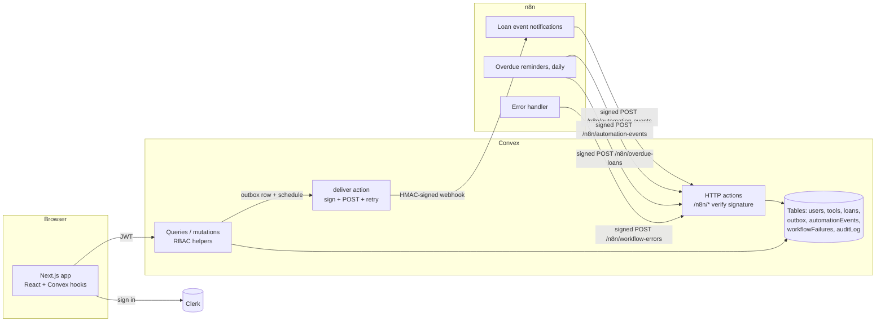
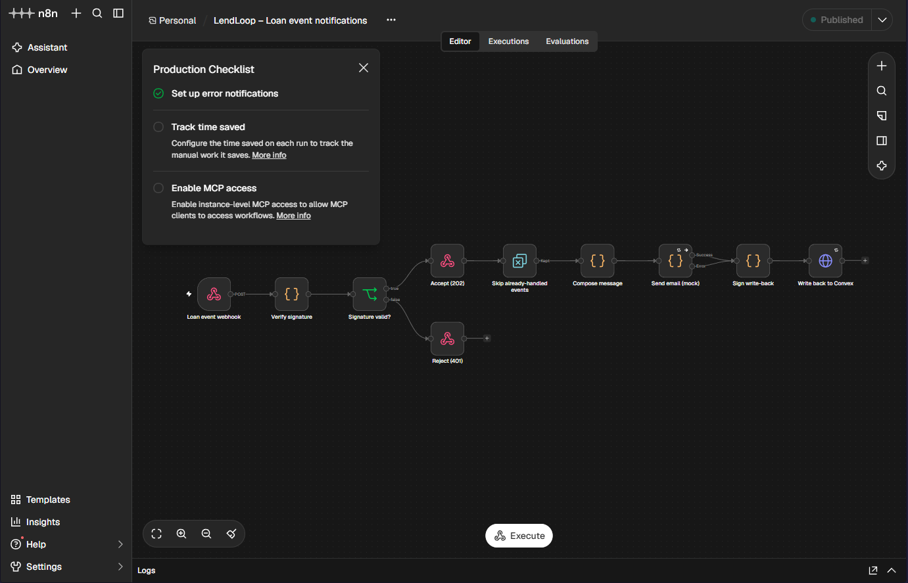
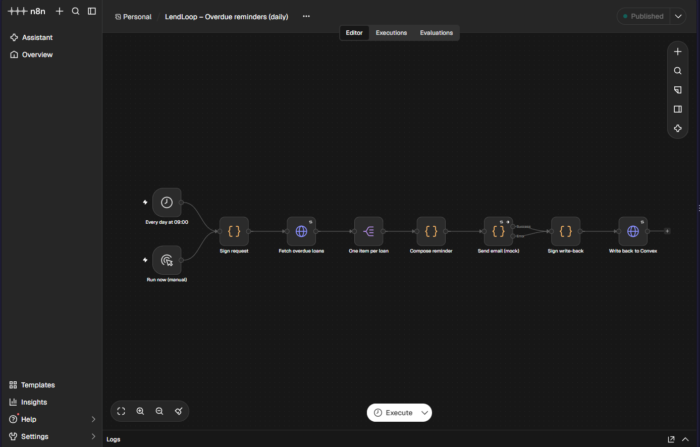
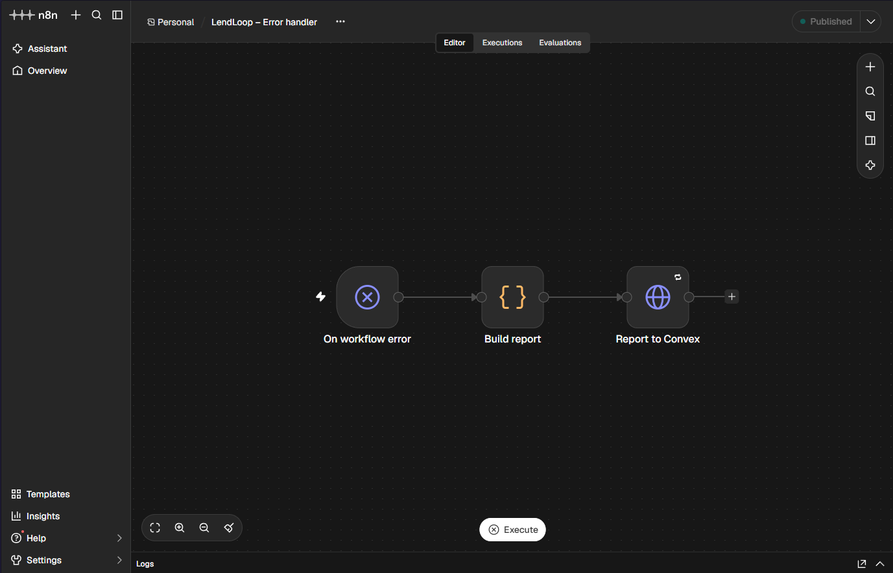
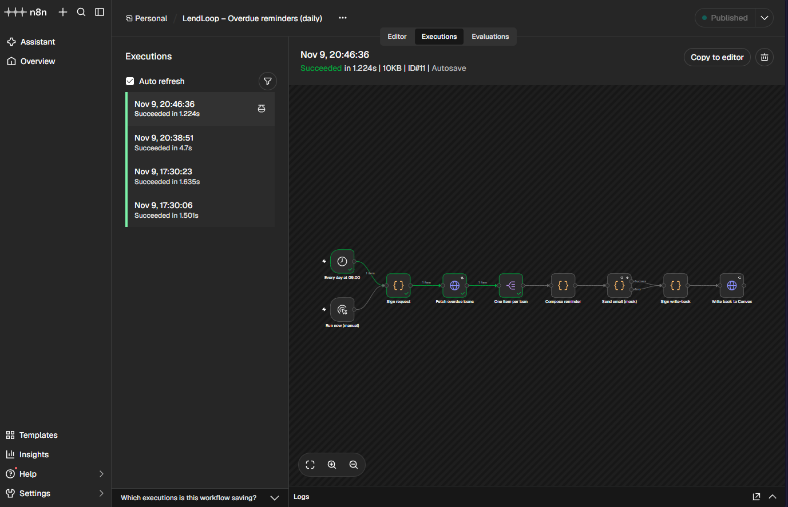
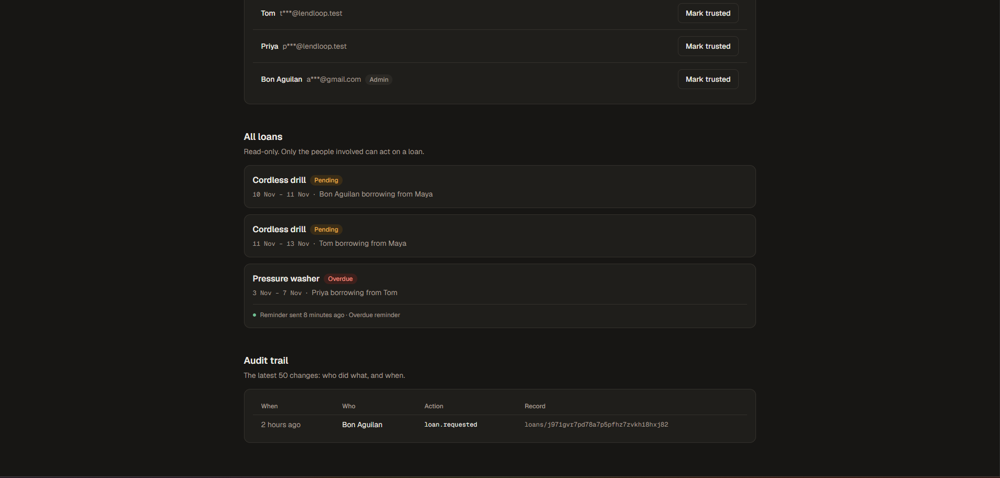

# LendLoop

**Borrow what you need. Lend what you don't.**

A neighbourhood tool-lending board. Neighbours list tools, request to borrow them for a date range, and get notifications and overdue reminders sent by n8n.

Built with Next.js 16 (App Router), Clerk, Convex, n8n and TypeScript, as a take-home for Fluence.

- [Live demo](#live-demo)
- [What's in it](#whats-in-it)
- [Architecture](#architecture)
- [Local setup](#local-setup)
- [Environment variables](#environment-variables)
- [Security and data minimisation](#security-and-data-minimisation)
- [n8n integration: reliability and error handling](#n8n-integration-reliability-and-error-handling)
- [Tests](#tests)
- [Project layout](#project-layout)
- [Running it in production](docs/PRODUCTION.md)

## Live demo

**https://lendloop-kappa.vercel.app**: sign up with any email or Google (Clerk runs in development mode, so you'll see its badge). It has demo data: three neighbours, six tools, a pending request and an overdue loan.

- **n8n isn't connected to the live site.** The deployment has no public n8n instance, so loan events are recorded as `skipped` instead of being sent. Admins can see them under **Admin → Automation health**. Both workflows and the error handler were tested end to end against a local n8n (see [n8n integration](#n8n-integration-reliability-and-error-handling)). The overdue-reminder workflow was also run from a local n8n against the live Convex backend, so the overdue demo loan shows a real "Reminder sent" entry ([screenshots](#screenshots)).
- **Admin features:** new accounts are plain users, and admin can only be granted from the Convex CLI. To try the admin view (remove any listing, all loans, Trusted Lender, automation health, audit trail), email aguilanbon@gmail.com and I'll upgrade your account, or run it locally with `npx convex run users:grantAdmin`.

## What's in it

| Spec item | Where |
| --- | --- |
| Public page with tagline, available tools (name and category only), "Sign in to lend or borrow" | [`src/app/page.tsx`](src/app/page.tsx), [`tools.listPublic`](convex/tools.ts) |
| List a tool (name, category, condition, description); edit and delete your own | `/listings`, [`convex/tools.ts`](convex/tools.ts) |
| Browse all tools with availability, filter by category, request a date range | `/tools` |
| My listings, My requests, Incoming requests | `/listings`, `/requests`, `/incoming` |
| Approve, decline, mark returned (lender); cancel (borrower) | [`convex/loans.ts`](convex/loans.ts) |
| Admin: remove any listing (Remove button on Browse), view all loans, mark Trusted Lender | `/tools`, `/admin`, [`convex/users.ts`](convex/users.ts) |
| RBAC enforced in Convex functions | [`convex/lib/auth.ts`](convex/lib/auth.ts) |
| n8n workflow 1: request created / status changed → notify the right person | [`n8n/workflows/1-loan-event-notifications.json`](n8n/workflows/1-loan-event-notifications.json) |
| n8n workflow 2: daily overdue reminders with status written back | [`n8n/workflows/2-overdue-reminders.json`](n8n/workflows/2-overdue-reminders.json) |
| Error workflow, failures visible in the app | [`n8n/workflows/0-error-handler.json`](n8n/workflows/0-error-handler.json), `/admin` |
| HMAC signatures both ways, idempotent write-backs, retries | [`convex/lib/hmac.ts`](convex/lib/hmac.ts), [`convex/notifications.ts`](convex/notifications.ts), [`convex/http.ts`](convex/http.ts) |
| Bonus: automation activity on each loan ("Reminder sent 2 days ago") | [`LoanCard`](src/components/LoanCard.tsx) |
| Extra: audit trail of every change, admin view of failed deliveries with retry | `/admin` |

## Architecture



- **Next.js** renders the UI. Pages are client components that read Convex through live queries, so lists update in real time. Signed-out visitors on a private page are redirected to sign in by the app shell. That is a convenience; access is enforced in Convex. `src/proxy.ts` (Next 16's renamed middleware) only runs Clerk's session handling, following Clerk's guidance to check auth where the data is rather than by URL pattern.
- **Clerk** handles sign-in. Convex verifies the Clerk JWT (`convex/auth.config.ts`). On first load the app calls `users.ensureUser`, which creates the user row from the token. The role always starts as `user`.
- **Convex** holds all data and all rules. Every public function starts with one of `requireUser`, `requireAdmin`, `requireToolOwner` or `requireLoanParty`.
- **n8n** sends notifications and reminders. It never talks to the database. It only sees what Convex chooses to send, and writes back through three signed HTTP endpoints.

### Loan status machine

```text
pending ──approve (lender)──▶ approved ──mark returned (lender)──▶ returned
   ├──decline (lender)──▶ declined
   └──cancel (borrower)─▶ cancelled ◀── cancel (borrower, before the start date)
```

Approving a request automatically declines other pending requests for overlapping dates, and new requests can't overlap an approved loan. "Overdue" isn't stored: it's an approved loan whose end date has passed.

## Local setup

You need Node 20+ (tested on Node 24), a Convex account, a Clerk account, and either Docker or `npx` for n8n.

### 1. App and Convex

```bash
npm install
npx convex dev          # first run: log in, create a project; writes .env.local
```

Keep `npx convex dev` running in its own terminal. It pushes functions on every save.

### 2. Clerk

1. Create a Clerk application. Copy the publishable and secret keys into `.env.local` (see [`.env.example`](.env.example)).
2. In **Configure → JWT templates**, create a template named `convex` with these claims:
   `{ "aud": "convex", "name": "{{user.full_name}}", "email": "{{user.primary_email_address}}" }`
   (Clerk's one-click Convex integration also works for sign-in, but its token has no email, so notifications would be skipped.)
4. Copy your **Frontend API URL** and give it to Convex:

   ```bash
   npx convex env set CLERK_JWT_ISSUER_DOMAIN https://<your-instance>.clerk.accounts.dev
   ```

### 3. Run the app

```bash
npm run dev             # http://localhost:3000
```

Sign in once, then make yourself an admin. This is an internal mutation, so it can't be called from a browser:

```bash
npx convex run users:grantAdmin '{"email":"you@example.com"}'
```

Optional demo data (three neighbours, six tools, one pending request and one overdue loan):

```bash
npx convex run seed:demo
# or make the overdue loan yours, so the reminder goes to you:
npx convex run seed:demo '{"borrowerEmail":"you@example.com"}'
```

### 4. n8n

Generate two secrets and give them to Convex:

```bash
npx convex env set CONVEX_TO_N8N_SECRET $(openssl rand -hex 32)
npx convex env set N8N_TO_CONVEX_SECRET $(openssl rand -hex 32)
npx convex env set N8N_LOAN_EVENTS_WEBHOOK_URL http://localhost:5678/webhook/lendloop/loan-events
```

#### Option A: Docker (recommended)

```bash
cp .env.n8n.example .env.n8n                # paste the same two secrets, set N8N_ENCRYPTION_KEY
docker compose --env-file .env.n8n up -d    # imports and publishes the three workflows
```

Open <http://localhost:5678> and create the owner account.

#### Option B: no Docker

```bash
export LENDLOOP_CONVEX_SITE_URL=http://127.0.0.1:3211   # or https://<deployment>.convex.site
export CONVEX_TO_N8N_SECRET=...  N8N_TO_CONVEX_SECRET=...
export NODE_FUNCTION_ALLOW_BUILTIN=crypto N8N_BLOCK_ENV_ACCESS_IN_NODE=false
npx n8n import:workflow --separate --input=n8n/workflows
npx n8n publish:workflow --id=LendLoopErrorsWF
npx n8n publish:workflow --id=LendLoopNotifyWF
npx n8n publish:workflow --id=LendLoopRemindWF
npx n8n start
```

**Which Convex URL?** n8n calls Convex at `LENDLOOP_CONVEX_SITE_URL`, and Convex calls n8n at `N8N_LOAN_EVENTS_WEBHOOK_URL`. A Convex **cloud** deployment can't reach `localhost`, so with cloud Convex either expose n8n through a tunnel (e.g. `cloudflared tunnel --url http://localhost:5678`) or use n8n Cloud. A Convex **local** deployment (`npx convex dev --local`) and local n8n reach each other directly.

**Try it:**

- Request a tool as one user, then check the n8n executions list: the lender's notification is logged by the "Send email (mock)" node, and a minute later the loan shows "Notification sent just now".
- Open "LendLoop – Overdue reminders" and click **Execute workflow** to run the daily job now.
- To see the failure path, give a user an email ending in `@fail.test`: the mock provider fails, n8n retries 3 times, and the loan shows "Notification failed".
- Stop Convex and run the reminder workflow: the HTTP node retries, the run fails, the error handler reports it, and it appears under **Admin → Automation health** once Convex is back. (The error handler's own HTTP call retries 5 times over ~40 seconds.)

### 5. Deploy (Vercel)

`vercel.json` sets the build command to `npx convex deploy --cmd 'npm run build'`, so each deploy pushes Convex functions to production and then builds Next.js against them.

1. Convex dashboard → your project → **Production** → Settings → generate a **Production deploy key**.
2. Import the repo in Vercel. Add `CONVEX_DEPLOY_KEY` (Production environment only, so previews never deploy to prod), `NEXT_PUBLIC_CLERK_PUBLISHABLE_KEY` and `CLERK_SECRET_KEY`.
3. Set the Convex prod env vars with `npx convex env set --prod ...` (same list as above), then `npx convex run --prod seed:demo` for demo data.

## Environment variables

| Variable | Where it lives | What it's for |
| --- | --- | --- |
| `CONVEX_DEPLOYMENT`, `NEXT_PUBLIC_CONVEX_URL`, `NEXT_PUBLIC_CONVEX_SITE_URL` | `.env.local` (written by `npx convex dev`) | Which Convex deployment the app uses |
| `NEXT_PUBLIC_CLERK_PUBLISHABLE_KEY`, `CLERK_SECRET_KEY` | `.env.local` | Clerk keys |
| `CLERK_JWT_ISSUER_DOMAIN` | Convex env | Issuer Convex trusts for Clerk JWTs |
| `N8N_LOAN_EVENTS_WEBHOOK_URL` | Convex env | n8n webhook for loan events. If unset, events are marked "skipped" and the app still works |
| `CONVEX_TO_N8N_SECRET` | Convex env **and** n8n env | Convex signs webhooks with it; n8n verifies |
| `N8N_TO_CONVEX_SECRET` | Convex env **and** n8n env | n8n signs its calls with it; Convex verifies |
| `LENDLOOP_CONVEX_SITE_URL` | n8n env | Base URL of Convex HTTP actions (`…convex.site` or `:3211` locally) |
| `N8N_ENCRYPTION_KEY` | n8n env (`.env.n8n` for Docker) | Encrypts n8n's stored credentials |
| `NODE_FUNCTION_ALLOW_BUILTIN=crypto`, `N8N_BLOCK_ENV_ACCESS_IN_NODE=false` | n8n env | Let Code nodes compute HMACs and read the two secrets from env |

No secret is in the code or in the workflow JSON. `.env*` files are git-ignored except the two examples.

## Security and data minimisation

**Access control lives in Convex.**

- Every public query and mutation starts with an auth helper ([`convex/lib/auth.ts`](convex/lib/auth.ts)). Hiding a button in the UI is a convenience, never the protection.
- Users can create, edit and delete only their own listings (`requireToolOwner`). Admins can remove any listing but can't edit someone else's words.
- Only the lender can approve, decline or mark returned. Only the borrower can cancel. The lender confirms the return because they're the one who gets the tool back.
- Admins can *view* all loans but can't act on them. Least privilege: moderation doesn't need it.
- Someone who isn't a party to a loan gets `NOT_FOUND`, not `FORBIDDEN`, so the response doesn't confirm the loan exists.
- Roles are never accepted from the client. `ensureUser` takes no arguments; admin is granted only through an internal mutation run from the CLI.
- All inputs are validated by Convex validators, then checked again for business rules: trimmed lengths, real calendar dates, no past dates, max 30-day loans, max 90 days ahead, one pending request per tool, and a cap of 10 pending requests per borrower.
- Errors sent to the browser are `ConvexError`s with a code and a plain message. Internals are never exposed.

**Each audience gets only the data it needs.**

- **Public page:** `listPublic` returns `{ name, category }` only, with no ids, owners, descriptions or dates.
- **Signed-in neighbours** see a lender's display name and Trusted Lender badge, never an email address.
- **Admins** see emails masked (`a***@example.com`): enough to tell two "Alex"es apart.
- **n8n** gets a payload built for one notification: the recipient's name and email, the other person's display name, the tool name and the dates. No user ids, roles, descriptions, or the other person's email. A test checks the borrower's email never appears in an event meant for the lender.
- **Overdue reminders:** the endpoint returns only the borrower's name and email, tool name, due date and days overdue.
- **The audit log** stores ids and action names, never user-written text.
- **Logs:** the mock email node logs a masked address. The n8n compose file prunes execution history after 7 days, because execution data holds names and emails.
- **Listings** are soft-deleted, so loan history and the audit trail stay intact.

**Signing in both directions.**

- Each request carries `X-LendLoop-Timestamp` and `X-LendLoop-Signature: v1=HMAC-SHA256(secret, "timestamp.rawBody")`.
- Receivers reject timestamps more than 5 minutes off, which stops replays of captured requests.
- Convex compares with `crypto.subtle.verify` and n8n with `crypto.timingSafeEqual`. Both are constant-time.
- n8n verifies the **raw** request bytes, not a re-serialised copy of the JSON.
- There is one secret per direction, so leaking one doesn't open both. The test suite pins a known HMAC vector so the Web Crypto (Convex) and Node `crypto` (n8n) implementations provably agree.
- Signature failures return a generic `401 unauthorized`. The reason is only logged server-side.
- The HTTP endpoints cap bodies at 64 KB and validate them with zod before touching data.

## n8n integration: reliability and error handling

**Convex → n8n (loan events): a transactional outbox.**

1. A loan mutation writes an `outbox` row and schedules the `deliver` action in the same transaction. If the mutation rolls back, no event is sent; if it commits, the event can't be lost.
2. `deliver` signs the stored body *at send time*, so a retry hours later still passes the freshness check. It POSTs with a 10-second timeout.
3. Network errors, timeouts, 5xx, 408 and 429 are retried with backoff: 10 s, 1 min, 5 min, 30 min, 2 h. Other 4xx (bad signature, wrong URL) fail at once, because retrying can't fix them.
4. After the last attempt the row is `failed` and shows under **Admin → Automation health** with a **Retry** button.

**Exactly-once effects on top of at-least-once delivery.**

- Each event has a stable id, `<loanId>.<eventType>`; each transition happens at most once per loan.
- The n8n workflow answers `202` straight after verifying the signature. Then a *Remove Duplicates* node (across executions) drops any event id it has already handled. A retry after a lost response never sends a second email.
- Every write-back to Convex carries an idempotency key:
  - `notification:<eventId>`
  - `reminder:<loanId>:<YYYY-MM-DD>` (one reminder per loan per day)
- Convex upserts on that key. The same key twice gives one row. `failed → sent` upgrades it after a successful retry, and `sent` is never downgraded by a late, stale retry.
- The key must belong to the loan it names, or the request is rejected.
- The overdue endpoint leaves out loans already reminded today, so re-running the daily job doesn't spam anyone.

**Retries and failure visibility inside n8n.**

- The email node retries 3 times. If it still fails, its error output records a `failed` status in Convex instead of stopping the run, so one bad address doesn't block other borrowers' reminders. The loan then shows "Reminder failed".
- HTTP calls to Convex retry 3–5 times with waits.
- Both workflows set **LendLoop – Error handler** as their error workflow. It posts a short report (workflow, node, message, execution id; no personal data) to `/n8n/workflow-errors`. That is idempotent on the execution id and shown to admins in the app. Failures never sit unnoticed inside n8n.

**Workflow JSON contains no credentials.** Secrets come from env vars at run time. The workflows have fixed ids, so CLI or Docker import keeps the error-workflow link. If you import through the UI instead, re-select the error workflow under each workflow's **Settings**. In n8n 2.x the error handler must be **published** as well, or n8n won't run it.

All three workflows were tested end to end on n8n 2.46.7 against a local Convex backend: a signed event delivered and written back, a bad signature rejected with 401, a replayed event producing no duplicate, the mock provider failing and being recorded as `failed` after 3 tries, a malformed event tripping the error handler (and showing up in Convex), and the daily reminder sending once and finding nothing to send on a second run.

### Screenshots

**Loan event notifications.** Verify the signature, answer 401 or 202, drop events already handled, compose, send (mock) with retries, write the result back signed.



**Overdue reminders (daily).** Signed fetch of overdue loans from Convex, one reminder per loan, status written back with an idempotency key.



**Error handler.** Set as the error workflow of the two above; reports failed runs to Convex so admins see them in the app.



**A second reminder run on the same day.** It fetches from Convex, finds nothing (the loan was already reminded today) and sends nothing.



**The result on the live site** (Admin → All loans). The reminder written back by n8n shows on the overdue loan.



## Tests

```bash
npm test          # 44 backend tests (convex-test + vitest)
npm run lint
npm run typecheck
```

The tests cover:

- **RBAC negative cases:** a stranger can't approve, decline or cancel; a borrower can't approve their own request; a lender can't cancel for the borrower; a non-owner can't edit or delete a listing; an admin can remove but not edit; non-admins are refused every admin function.
- **The status machine:** illegal transitions, overlap auto-decline and date validation.
- **Data minimisation:** the exact public and webhook payload shapes.
- **Signatures:** missing, wrong, stale and tampered requests.
- **Write-back idempotency:** duplicates, the failed→sent upgrade, no downgrade, and a key that doesn't match its loan.
- **Outbox behaviour:** a signed body, retry on 5xx, fail fast on 4xx, give up then admin retry.

## Project layout

```text
convex/
  schema.ts            tables and indexes
  lib/auth.ts          requireUser / requireAdmin / requireToolOwner / requireLoanParty
  lib/hmac.ts          signing + verification (Web Crypto)
  tools.ts loans.ts users.ts admin.ts      public functions
  notifications.ts     outbox + signed webhook delivery with retries
  http.ts automation.ts  signed n8n endpoints and their internal functions
  seed.ts              demo data (internal)
  *.test.ts            tests
src/
  app/page.tsx         public page
  app/(app)/*          signed-in pages
  components/          UI
  proxy.ts             Clerk session middleware
n8n/workflows/         exported workflows (no credentials)
docker-compose.yml     self-hosted n8n that imports the workflows
docs/PRODUCTION.md     what I'd change for production
```
